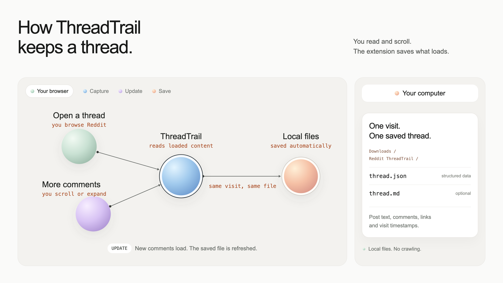

# Reddit ThreadTrail

A Chromium extension that saves the Reddit pages you open as local JSON files. Markdown copies are optional.



## Install

1. [Download the latest ZIP](https://github.com/olegkhomenko/reddit-threadtrail/releases/latest) and extract it.
2. Open `chrome://extensions` (Chrome/Chromium), `brave://extensions` (Brave), or `edge://extensions` (Edge).
3. Enable **Developer mode**, click **Load unpacked**, and select the extracted folder containing `manifest.json`.
4. Turn off **Ask where to save each file** in your browser's Downloads settings for automatic saves.
5. Reload existing Reddit tabs, then open a thread. Files appear in **Downloads / Reddit ThreadTrail**.

You can also clone this repository and load its folder directly. No build or account setup is required.

## What it saves

- Thread title, text, subreddit, author, score, links and timestamps.
- Loaded comments, including IDs and parent IDs for rebuilding reply trees.
- Loaded post summaries from feeds and search pages.
- A visit ID and capture time in every file.

Each visit gets one JSON file. Newly loaded comments update that file; returning to the page creates a new visit. Previously captured comments stay in the file when collapsed. Media URLs may be included, but media files aren't downloaded.

## While you browse

Normal updates check for changes every 20 seconds. Reaching the bottom triggers an earlier check and watches for delayed comment loads, even when they push the bottom out of view. Unchanged content doesn't trigger another download.

The popup provides **Pause / Resume**, **Capture now**, recent captures and file locations. Settings control the output subfolder, Markdown copies, and feed/search capture. Folder and format changes apply to new visits.

**Export visit index** saves metadata for the latest 200 visits. Older thread files stay on disk. Dates inside files and folder names use UTC.

## Files and limits

The default path is `Downloads/Reddit ThreadTrail/<date>/<subreddit>/<visit>.json`. Subfolders are configurable; absolute paths aren't supported. Existing installations keep their saved folder setting.

JSON contains `visit`, `page`, `thread`, `posts`, `comments` and `coverage`. Use `comments[].parent_id` for reply relationships and `thread.id` to group repeat visits. The `source` value remains `reddit-dump` for compatibility with earlier archives.

Only content loaded in a viewed tab is captured. This is a partial thread archive: no crawling, automatic comment expansion, previous browsing history or uploads to a server. Profile, inbox, chat and settings pages are excluded. Modern and Old Reddit are supported; layout changes can affect extraction.

Tab closing may interrupt the final save. Use **Capture now** before leaving if the latest comments matter. Captures over roughly 2 MB report an error rather than silently dropping content.

## Development

```sh
npm test
npm run test:browser
npm run package
```

Tests use Node 22+ and synthetic Reddit pages. Browser tests default to Brave on macOS; set `CHROMIUM_BINARY` for another compatible Chromium executable. Packaging writes `../reddit-threadtrail.zip`.

[Diagram source](docs/how-it-works.html) · [Changelog](CHANGELOG.md)
